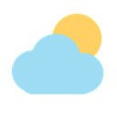
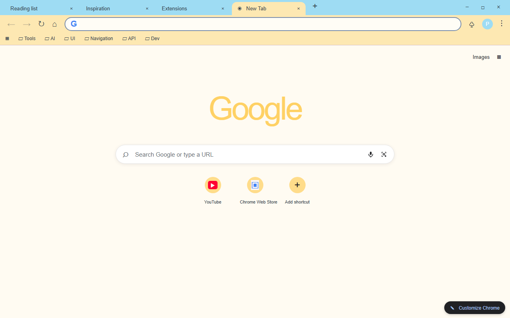
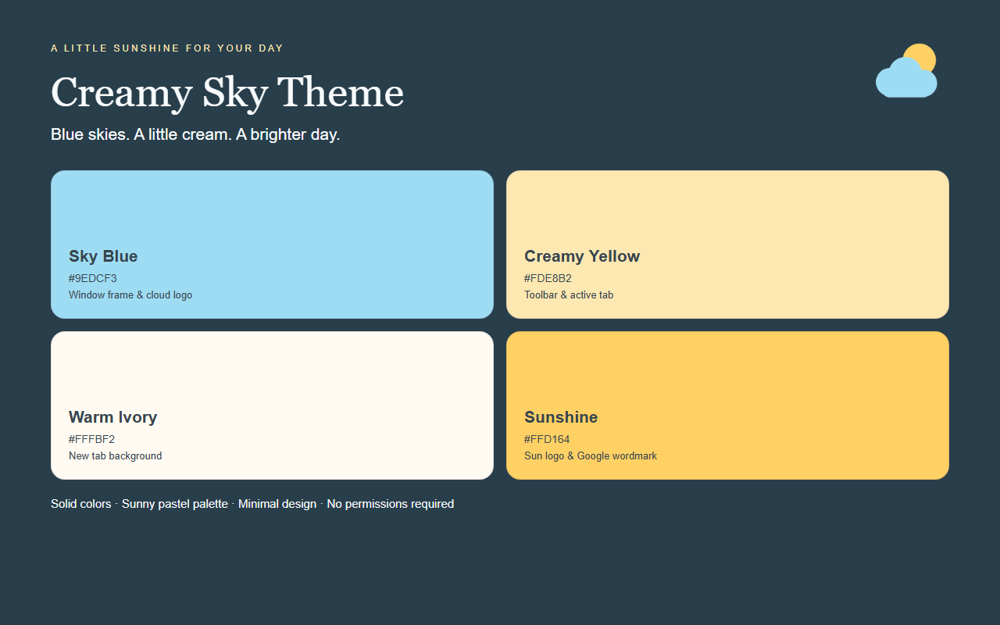
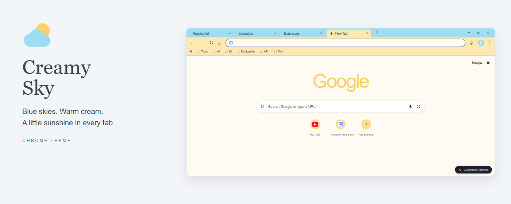
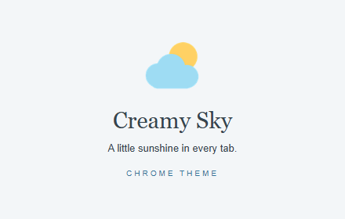

<p align="center">
  
</p>

<h1 align="center">Creamy Sky Theme</h1>

<p align="center">A bright Chrome theme in sky blue, creamy yellow, and warm ivory, with a sunny new tab page.</p>

<p align="center">
  
  
</p>

## About

Creamy Sky Theme pairs a clear sky-blue window frame with a creamy yellow toolbar and active tab, while a warm ivory new tab page keeps the browser light and airy. Blue-gray text and icons stay readable on every surface, including tabs, bookmarks, and the address bar.

Every layer is one flat solid color — no wallpaper, no gradients, no patterns. The window frame stays the same color when the window loses focus, so the theme never flickers between two shades while you switch windows. The palette lives entirely in the theme definition; there are no scripts, no permissions, and no data collection.

## Color Palette

| Token | Hex | Usage |
|-------|-----|-------|
| Sky Blue | `#9EDCF3` | Window frame and tab strip |
| Creamy Yellow | `#FDE8B2` | Toolbar, active tab, bookmarks bar |
| Warm Ivory | `#FFFBF2` | New tab page background |
| Light Cream | `#FFFDF6` | Address bar fill |
| Blue Gray | `#36454E` | Tab labels, toolbar icons, body text |
| Clear Blue | `#367499` | New tab links and page header |
| Sunshine | `#FFD164` | Logo sun and the new tab Google mark |

## Chrome UI Notes

Chrome paints a few parts of the window itself instead of reading them from the theme, so the store screenshots follow what a real install renders:

- **New tab Google mark:** Chrome computes a single flat color from the new tab background and lands on `#FFD164` here, rather than the four-color brand logo.
- **Shortcut tiles:** Chrome tints the round shortcut buttons from the new tab background, rendering them as pale yellow circles.
- **Address bar:** the omnibox fill stays close to the light cream `#FFFDF6`, because Chrome blends it against the themed toolbar.
- **Window buttons:** the minimize, maximize, and close glyphs stay dark against the light blue frame.
- **Inactive frame:** `frame_inactive` is set to the same sky blue as `frame`, so an unfocused window keeps the same color.

## Features

- Sky-blue window frame with a creamy yellow toolbar and active tab.
- Warm ivory new tab page with blue-gray text, tuned for comfortable reading.
- Flat single-color surfaces on every layer, with no wallpaper or image assets.
- A sun-and-cloud icon in the same palette, drawn as one flat shape without outlines or shadows.
- Theme-only package: Chrome applies it straight from the manifest, with no permissions and no background code.

## Install

### From source (unpacked)

1. Download or clone this repository.
2. Open Chrome and go to `chrome://extensions`.
3. Turn on **Developer mode** in the top right corner.
4. Click **Load unpacked** and select this folder.
5. Open a new tab to see the theme. To undo it, go to Settings → Appearance → Themes → Reset to default.

### From Chrome Web Store

Coming soon — the install link will be added here once the theme is published.

## Preview

**Browser interface** — the themed window with the bookmarks bar and a new tab page:



**Palette and surfaces** — the theme colors with their roles:



**Marquee promo (1400x560):**



**Small promo (440x280):**



The screenshots and promo images are illustrative HTML/CSS layouts rendered by headless Chromium and calibrated against a real install of this theme, not native captures. Native controls can vary by browser version and OS.

## Files

| File | Description |
|------|-------------|
| `manifest.json` | Chrome theme manifest (MV3) with the inline `theme` config |
| `logo/logo128.png` | Theme icon (128x128), the only icon size a Chrome theme uses |
| `store-assets/screenshots/en/` | Store listing screenshots (1280x800) |
| `store-assets/promo/` | Small promo (440x280) and marquee promo (1400x560) |
| `store-assets/references/` | HTML sources and reference renders behind the store artwork |
| `store-assets/ASSET-NOTES.md` | Calibration notes for the store artwork |
| `store-assets/store-description.txt` | Store listing copy (English) |
| `scripts/generate-logo.py` | Draws the theme icon |
| `scripts/generate-store-assets.py` | Renders every store image from one HTML/CSS source |
| `scripts/package.ps1` | Builds the release ZIP |

## Regenerate Assets

```bash
pip install -r scripts/requirements.txt
playwright install chromium
python scripts/generate-logo.py
python scripts/generate-store-assets.py
```

The introduction screenshot has an overflow assertion, so a layout that no longer fits fails the build instead of shipping.

## Package

```powershell
powershell -File scripts/package.ps1
```

By default the archive lands in the parent folder of the themes workspace; pass `-OutputDirectory` to change that and `-Force` to replace an existing file. `manifest.json` stays at the ZIP root, the manifest's icon reference is checked against the archive, and store artwork is uploaded separately.

## License

Non-Commercial License — free for personal use, commercial use requires permission. See [LICENSE](LICENSE).
